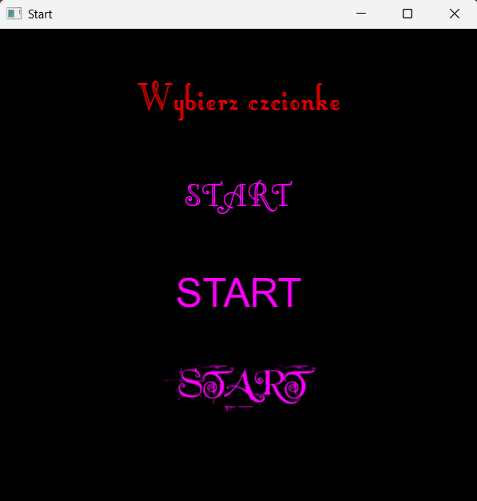
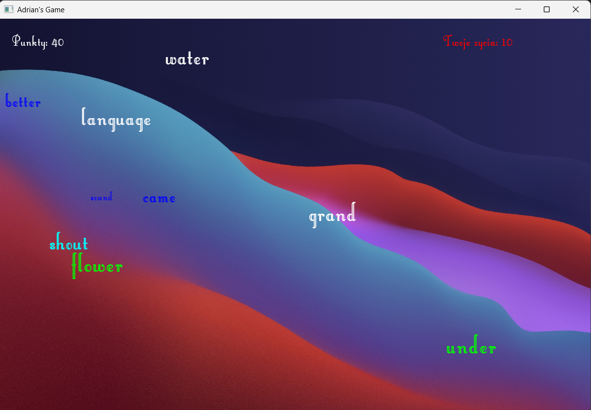
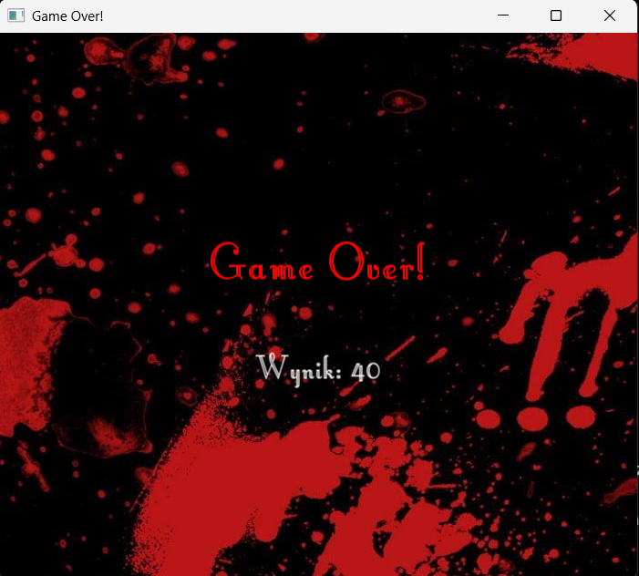

# Monkey Typer Game

A simple 2D typing game developed in **C++20** using the **SFML 2.6.1** library. The goal is to type moving words correctly before they reach the right edge of the screen.

## Features

- Random word generation from an external text file.
- Animated words with randomized colors, sizes, and movement speeds.
- Real-time keyboard input and word matching.
- Scoring system awarding 10 points for each correctly typed word.
- Life system with a maximum of 10 missed words.
- Selection of three different fonts before starting the game.
- Game Over screen displaying the final score.

## Technologies

- **C++20** – game logic and input processing.
- **SFML 2.6.1** – graphics rendering, window management, and event handling.
- **CMake** – build configuration and dependency management.
- **C++ Standard Library** – containers, strings, randomization, and file handling.

## Screenshots

### Main Menu



### Gameplay



### Game Over



## Installation and Running

### Requirements

- A C++20-compatible compiler.
- CMake 3.24 or newer.
- Git.
- An internet connection for downloading SFML during the initial build.

### Building the Project

Clone the repository:

```bash
git clone https://github.com/AdrianJastrzebski4/MonkeyTyperGame.git
cd MonkeyTyperGame
```

Configure and build:

```bash
cmake -S . -B build
cmake --build build
```

SFML 2.6.1 is automatically downloaded using CMake FetchContent.

### Running

Run the generated executable from the project root directory so the game can locate its fonts, images, and `words.txt` file.

In CLion, set the **Working directory** in the Run Configuration to `$ProjectFileDir$`.

## How to Play

1. Launch the game and select one of the three available fonts.
2. Type the words displayed on the screen before they reach the right edge.
3. Earn 10 points for every correctly typed word.
4. Avoid missing words — each missed word costs one life.
5. The game ends after 10 missed words and displays your final score.

## Project Structure

```text
MonkeyTyperGame/
├── assets/
│   ├── fonts/
│   └── images/
├── screenshots/
│   ├── menu.png
│   ├── gameplay.png
│   └── gameover.png
├── main.cpp
├── words.txt
├── CMakeLists.txt
├── .gitignore
└── README.md
```

## Author

Developed by Adrian Jastrzębski.